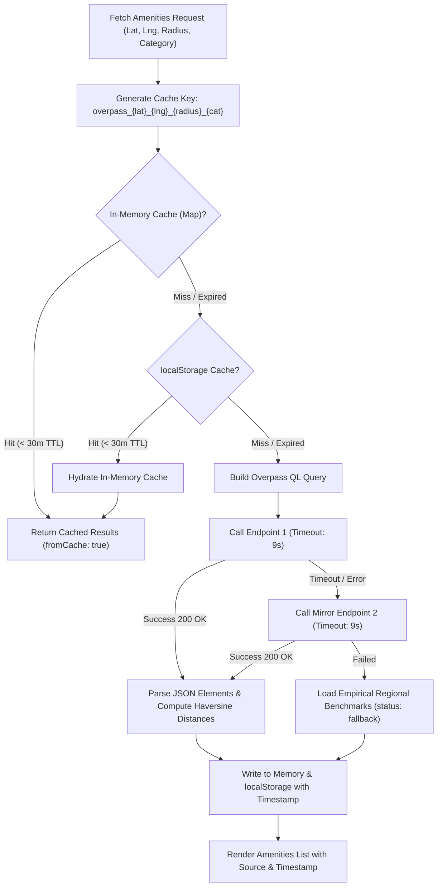

# PRABRIX AI - Phase 7: Geospatial & Valuation Documentation

This document describes the architectural implementation, operational parameters, and compliance rules of the **OSM Overpass Geospatial Intelligence Engine** and the **Comparative Valuation Module** built according to Sections 11 and 12 of `PROJECT_SPEC.md`.

---

## 1. Architectural Overview

Phase 7 introduces two independent, empirically grounded subsystems designed to furnish parcel-level spatial and economic clarity without engaging in market speculation:

1. **OSM Overpass Geospatial & Amenities Lookup Service**:
   - Queries OpenStreetMap via Overpass API to locate nearby transportation corridors (highways, stations), civic & healthcare utilities (hospitals, schools, government offices), and commercial nodes (markets, industrial estates).
   - Strict adherence to OpenStreetMap and Overpass usage policies (polite timeouts, mirror failover, in-memory/localStorage caching, debouncing, and full data provenance).
   - All spatial distances are mathematically calculated via the Haversine spherical formula and **strictly labeled as "Straight-line distance (aerial)"**.

2. **Multi-Source Comparative Valuation Engine**:
   - Formulates an **indicative valuation range only** when adequate verified comparable evidence exists ($\ge 2$ registered deed records in the micro-market).
   - Strictly enforces a fallback notice when fewer than 2 verified comps exist:  
     `"Insufficient verified comparable data for a reliable estimate."`
   - Keeps four fundamental pricing metrics **strictly separated** to avoid misleading buyers or sellers.
   - Enforces a statutory non-warranty legal disclaimer prohibiting guaranteed future appreciation or speculative escalation.

---

## 2. Centralized OSM Overpass Configuration

All Overpass API parameters, endpoints, and attribution text are defined centrally in [`src/config/overpassConfig.js`](file:///c:/MAIN_PROJECT/src/config/overpassConfig.js):

| Parameter | Configuration | Purpose |
|---|---|---|
| **Primary Endpoint** | `https://overpass-api.de/api/interpreter` | Main public Overpass server |
| **Mirror Endpoint** | `https://overpass.kumi.systems/api/interpreter` | Secondary failover mirror if primary is down/rate-limited |
| **Request Timeout** | `9000 ms` (9 seconds) | Client abort via `AbortController` to prevent hanging UI |
| **Debounce Delay** | `500 ms` | Inhibits burst network query spam when toggling filters |
| **Cache Duration** | `30 minutes` (`1,800,000 ms`) | In-memory and `localStorage` TTL |
| **Storage Key** | `prabrix_overpass_cache_v1` | Local browser cache key prefix |
| **Permitted Radii** | `1 km, 3 km, 5 km, 10 km` | Allowed aerial inquiry boundaries |
| **Data Source Attribution** | `OpenStreetMap via Overpass API` | Mandatory OpenStreetMap attribution under ODbL license |
| **Distance Type Label** | `Straight-line distance (aerial)` | Prevents mistaking aerial distance for road drive time |

---

## 3. Straight-Line Distance Calculation & Cache Flow

### 3.1 Haversine Aerial Distance Formula
$$\Delta\text{lat} = \text{lat}_2 - \text{lat}_1, \quad \Delta\text{lon} = \text{lon}_2 - \text{lon}_1$$
$$a = \sin^2\left(\frac{\Delta\text{lat}}{2}\right) + \cos(\text{lat}_1)\cos(\text{lat}_2)\sin^2\left(\frac{\Delta\text{lon}}{2}\right)$$
$$c = 2 \cdot \text{atan2}(\sqrt{a}, \sqrt{1 - a}), \quad d = R \cdot c \quad (R = 6,371 \text{ km})$$

All distances are calculated from the land parcel's centroid marker to the amenity's center node and rounded to two decimal places. Every user-facing UI badge explicitly states: **"straight-line"** aerial distance.

### 3.2 Two-Tier Caching Flowchart



---

## 4. Multi-Source Comparative Valuation Model

Section 12 of `PROJECT_SPEC.md` requires PRABRIX AI to maintain complete separation between seller aspirations, government benchmarks, verified deed evidence, and AI estimates.

### 4.1 The Four Strictly Separated Metrics

```
+---------------------------------------------------------------------------------------------------+
|  1. ASKING PRICE               2. GUIDELINE VALUE             3. OBSERVED VALUE                   |
|  ₹45.00 Lakhs                  ₹41.38 Lakhs                   ₹44.20 Lakhs                        |
|  Rate: ₹103.31 / sq.ft.        Rate: ₹95.00 / sq.ft.          Rate: ₹101.47 / sq.ft. (Avg)        |
|  Source: Seller Listed         Source: TNREGINET Benchmark    Source: 3 Verified SRO Sales Deeds  |
+---------------------------------------------------------------------------------------------------+
|  4. AI INDICATIVE RANGE (Adjusted Empirical Baseline - ±4% Bandwidth)                             |
|  ₹44.38 Lakhs - ₹48.08 Lakhs (Rate: ₹101.88 - ₹110.38 / sq.ft.)                                  |
|  Site Adjustments: +3% wide road access (30ft), +3% on-site borewell, +2% red soil fertility      |
|  Status: Empirical Range (Calculated only when >= 2 verified comps exist)                         |
+---------------------------------------------------------------------------------------------------+
```

1. **Asking Price (Seller Listed)**:
   - Self-reported by the landowner or authorized agent.
   - Calculated per unit area ($\text{Price} / \text{Area}_{\text{sqft}}$).
   - Never modified or replaced by AI.

2. **Guideline Value (Statutory Govt Benchmark)**:
   - Official Tamil Nadu Registration Department (TNREGINET) benchmark valuation for the relevant District, Taluk, and Village Panchayat.
   - Represents the statutory floor rate below which property cannot be registered without special valuation inquiry.

3. **Observed Value (Recent Verified Comparable Deeds)**:
   - Micro-market transaction deeds registered at the local Sub-Registrar Office (SRO) within the past 18 months.
   - Strict matching criteria: Same district, taluk, property type (agricultural / residential / commercial / industrial), and comparable scale.
   - Computes empirical minimum, maximum, and weighted-average square-foot rate.

4. **AI Indicative Valuation Range**:
   - **Range Only**: Expressed strictly as an interval $[\text{Low Total}, \text{High Total}]$ and $[\text{Low Rate}, \text{High Rate}]$. Never a single speculative exact price point.
   - **Empirical Baseline Adjustments**:
     - $+3\%$ for wide vehicular access road ($\ge 30$ ft) / $-4\%$ for narrow road approach ($< 15$ ft).
     - $+3\%$ for active on-site borewell or river canal water supply / $-3\%$ if no dedicated water source.
     - $+2\%$ for high-fertility red or alluvial soil.
   - **Conservative Bandwidth**: $\pm 4\%$ variance around the adjusted rate.

---

## 5. Inadequate Comparable Evidence Safeguard

In accordance with Section 12 requirements:
> *"The system shall output an indicative range only when adequate comparable evidence exists; otherwise it must state 'Insufficient verified comparable data for a reliable estimate.'"*

If fewer than 2 verified comparable sales deeds exist in the micro-market:
- `hasAdequateEvidence` is set to `false`.
- `metrics.aiIndicativeEstimate.status` is set to `'insufficient_evidence'`.
- The AI Indicative Range is suppressed.
- The system renders the standardized notice:
  > **"Insufficient verified comparable data for a reliable estimate."**
- The UI directs the user to request a certified field surveyor or independent valuer appraisal.

---

## 6. Statutory Non-Warranty Disclaimer (Rule 3 Compliance)

To satisfy Working Rule 3 and avoid fabricated projections, the following mandatory legal disclaimer is embedded in every valuation card, appraisal dossier, and export:

```
STATUTORY DISCLAIMER & NON-WARRANTY DECLARATION:
Valuations represent retrospective comparative assessments and indicative empirical ranges
based on registered deed records and government guideline benchmarks. PRABRIX AI does NOT
provide guaranteed future values, projected capital escalation, or speculative investment
returns. All property transactions require independent verification by a certified surveyor
and legal advocate.
```

---

## 7. Automated Test Coverage

The valuation and geospatial implementation is verified by 3 dedicated Vitest suites comprising 24 automated unit and UI integration tests:

1. [`src/test/overpassService.test.js`](file:///c:/MAIN_PROJECT/src/test/overpassService.test.js) (12 tests):
   - Centralized endpoint configuration, timeouts, TTL, and attribution.
   - Haversine spherical straight-line distance calculations and coordinate edge cases.
   - Overpass QL query syntax generation across transport, civic, and commercial categories.
   - In-memory and `localStorage` cache read/write/invalidation lifecycle.
   - Timeout handling, mirror failover, and empirical regional benchmark activation.
   - Ascending distance sorting and non-numeric coordinate validation.

2. [`src/test/valuationModule.test.js`](file:///c:/MAIN_PROJECT/src/test/valuationModule.test.js) (7 tests):
   - Strict separation of all 4 pricing metrics.
   - Indicative range calculation when $\ge 2$ comps are present.
   - Empirical physical adjustments (road width, water source, soil quality).
   - Inadequate evidence enforcement ($< 2$ comps and $0$ comps).
   - Null and corrupt input resilience.
   - Non-warranty statutory disclaimer validation.

3. [`src/test/phase7UI.test.jsx`](file:///c:/MAIN_PROJECT/src/test/phase7UI.test.jsx) (5 tests):
   - `NearbyAmenitiesView` rendering: category tabs, radius toggles (1, 3, 5, 10 km), straight-line badges, attribution timestamp, and invalid coordinate notice.
   - `ValuationBreakdown` rendering: 4 separated metric cards, comparable deeds table, and `"Insufficient verified comparable data for a reliable estimate."` alert.
